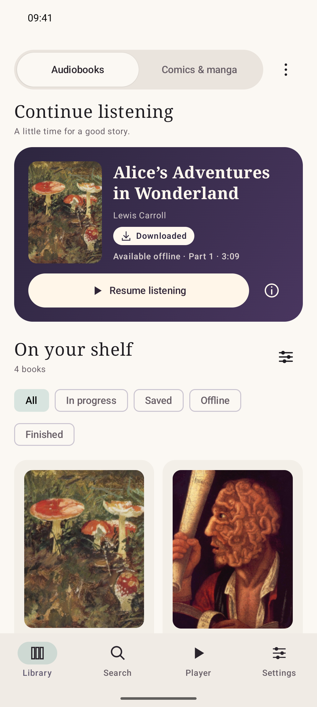
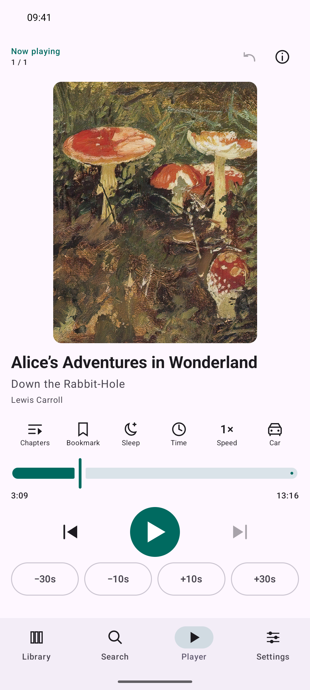
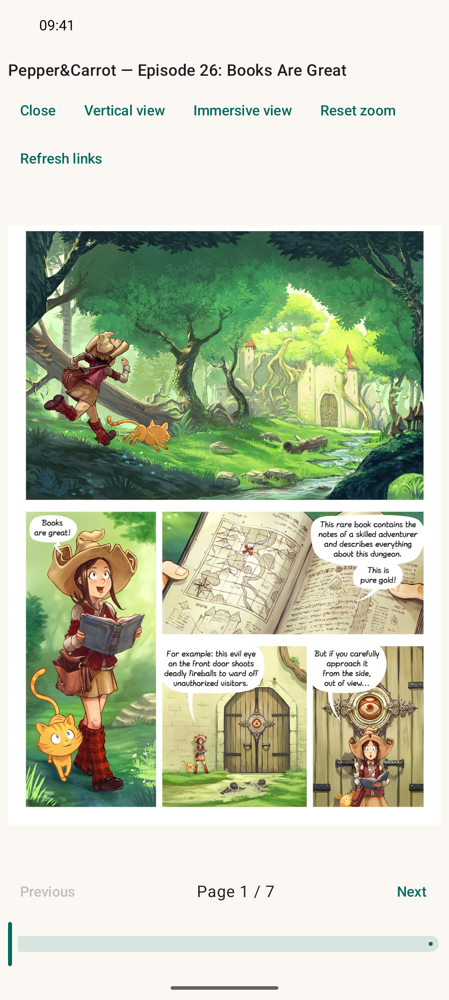

*This readme is human-written*

# DebridBooks

DebridBooks searches audiobooks and comics from your torrent sources and send them to your debrid provider (TorBox, Alldebrid). It also supports local reading of audiobook and comics

DebridBooks is intended for accessing public-domain works, openly licensed content, and other material you are authorized to access and download. Do not use it to infringe copyright. Users must comply with applicable laws and the terms of the services they use.

<INSERT F DROID LINK>

## Screenshots

|                                                                        Library                                                                        |                                                                             Player                                                                             |                                                                                Comics                                                                                |
| :---------------------------------------------------------------------------------------------------------------------------------------------------: | :------------------------------------------------------------------------------------------------------------------------------------------------------------: | :------------------------------------------------------------------------------------------------------------------------------------------------------------------: |
|  |  |  |

[Full screenshot credits](fastlane/SCREENSHOTS.md).

# Features

- Serverless : Unlike other stremio-like apps where a server is deployed somewhere, this app is entirely standalone. Plug your keys in the app and voila.
- Library: 
  - All your audiobooks and comics in one place
  - Download ebooks for lifetime offline storage
  - Find similar books
  - Rate your books
- Search:
  - Audiobooks 
  - Comics: Mangadex or torrent source toggle
  - Cover art
- Player:
  - Bookmark, time navigation, chapters..
  - Bedtime timer
  - Comics: vertical, page view...

# Source

- English : 
  - Torrent : Knaben, Audiobookbay
  - Comics-only: Mangadex
- French: C411, Tr4ker, YGGReborn

# Install

F droid should ALWAYS be preferred for security reason, as they build the APK from source. Unfortunately since this app is quite recent the f droid inclusion [has been rejected](https://gitlab.com/fdroid/fdroiddata/-/merge_requests/55289).   
In the meantime, download it from [github release](https://github.com/lonode/DebridBooks/releases). While waiting for f droid release, you can use [Obtainium](https://github.com/ImranR98/Obtainium) to always have the latest version.

## Requirements

- Android 8.0 or newer.

# Roadmap

The below depends on the requests received:

- Having a server to maintain a audiobooks vs hash cache status (similar as torrentio and other stremio addons) so that we can sort result by cache-first.
- Implement other debrid providers
- Other trackers
- Goodreads or other audiobook catalog integration
- Add normal books ?
- Adapting speed ?
- Add mobilism  ?

# Developpement

- `scripts/prepare-release.py` generates the f-droid changelog and tag.

# Help needed

Having a server to store hash/cache status will cost money, so any contributions is welcome.

*Thanks to AFK-Goblin, based on his work https://github.com/AFK-Goblin/BusTAudioBooks/*
