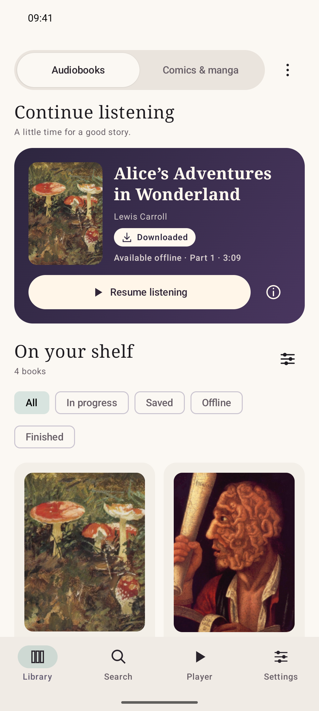
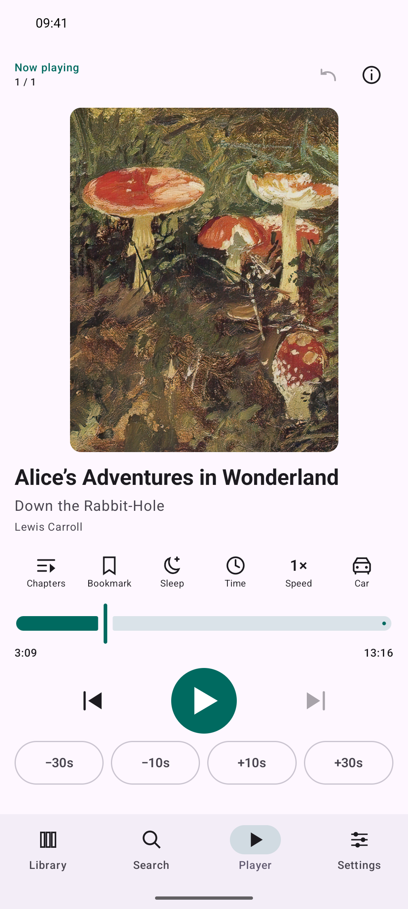
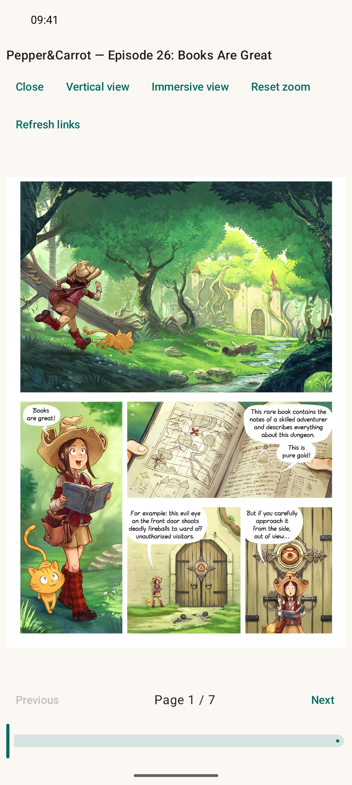

> Submission deferred following the development-age policy rejection. GitHub Releases now uses a maintainer signing key; the future F-Droid recipe is configured to verify the same signature. See [RELEASING.md](../RELEASING.md). Recheck the release hash, version, eligibility and pipeline before resubmitting.

## Abstract for new app inclusion

### Functions and usage

DebridBooks is a native Android audiobook player and comic reader, built with Kotlin, Jetpack Compose and AndroidX Media3.

Users configure their own AllDebrid account and optional source credentials. The app contacts providers, trackers and MangaDex directly; no DebridBooks server is required. It supports audiobook search and playback, chapter navigation, bookmarks, playback speed, sleep timers, offline downloads, comic reading in paged/vertical/fullscreen modes, and saved listening and reading progress.

- Source: https://github.com/lonode/DebridBooks
- Version: 1.0.0 (versionCode 1)
- Application ID: `io.github.lonode.debridbooks`
- Licence: AGPL-3.0-only; third-party notices are retained upstream
- Anti-feature: NonFreeNet, for AllDebrid
- Contact: https://github.com/lonode/DebridBooks/issues or mention `@lonode` upstream

No provider credentials or media are bundled with the app. Intended use is public-domain, openly licensed or otherwise authorized content.

|                                                                                                        Library                                                                                                         |                                                                                                  Audiobook player                                                                                                  |                                                                                                     Comic reader                                                                                                     |
| :--------------------------------------------------------------------------------------------------------------------------------------------------------------------------------------------------------------------: | :----------------------------------------------------------------------------------------------------------------------------------------------------------------------------------------------------------------: | :------------------------------------------------------------------------------------------------------------------------------------------------------------------------------------------------------------------: |
|  |  |  |

Comic shown: [Pepper&Carrot — Episode 26: Books Are Great](https://www.peppercarrot.com/en/webcomic-sources/ep26_Books-Are-Great.html), by David Revoy and contributors, [CC BY 4.0](https://creativecommons.org/licenses/by/4.0/). Artwork scaled to fit, with no artwork edits. [Full screenshot credits](https://github.com/lonode/DebridBooks/blob/99ede54ae5ce82d692f0af63b278a2614571d586/fastlane/SCREENSHOTS.md).

### Purpose and distinguishing features

The goal is to bring audiobook listening and comic reading into one standalone native Android library. The combination of direct source integration, AllDebrid resolution, MangaDex support and offline audio/comic access lets users keep their media and progress together without running a companion server.

### Development-age requirement

This is a new app and i'd like it to be distributed on a secure platform such as f droid, to give user some trust confidence: you are building the source.

## Checklist

### Policy

- [ ] The app complies with the [inclusion policy](https://f-droid.org/docs/Inclusion_Policy). Quality point 6 needs maintainer confirmation; see above.
- [x] The maintainer of this native app requests inclusion and does not oppose it. Third-party attribution and licence notices are retained.
- [x] The public tagged source contains Fastlane metadata in `en-US`, including descriptions, icon, six screenshots and the versionCode changelog.

### Docs

- [x] I have read [CONTRIBUTING.md](https://gitlab.com/fdroid/fdroiddata/-/blob/master/CONTRIBUTING.md).
- [x] I have reviewed the [metadata templates](https://gitlab.com/fdroid/fdroiddata/tree/master/templates).
- [x] I have read the [Build Metadata Reference](https://f-droid.org/docs/Build_Metadata_Reference/).
- [x] I have read the [Quick Start Guide](https://f-droid.org/en/docs/Submitting_to_F-Droid_Quick_Start_Guide/).

### Merge Request Setup

- [x] MR title is `New app: DebridBooks`.
- [x] My fdroiddata fork is public and the submission branch is not protected.
- [x] I have reviewed the Git/rebase guidance where needed. I will not rebase unless necessary to resolve a conflict.
- [x] Related fdroiddata and RFP issues have been referenced, if any exist.
- [x] This submission concerns one app only.

### Metadata

- [x] The MR adds only `metadata/io.github.lonode.debridbooks.yml`. Check the Changes tab before submission.
- [x] The prepared metadata is YAML using LF line endings.
- [x] Store text and images are supplied upstream, not added to this fdroiddata MR.
- [x] The release is publicly tagged `1.0.0`; tag-based automatic updates are enabled.
- [x] The metadata provides an issue tracker, author name and author website.
- [x] No external Git source repositories or srclibs are needed; dependencies are fetched through Gradle from Maven repositories.
- [x] ABI splitting was considered: the checked release APK is approximately 3.2 MiB, so separate ABI builds are not requested.
- [x] Only version 1.0.0 is included and no build entry is disabled.
- [x] `commit` is the full public hash `bed354928a28346e2c540b947d27ba7dbc031cb9`.

### Pipeline

- [ ] All GitLab MR pipelines pass.
- [ ] Any warnings and errors in the Reports tab are fixed or explained.
- [x] If GitLab asks for payment details or phone verification to run CI, I will leave a note for F-Droid maintainers to trigger it instead.

